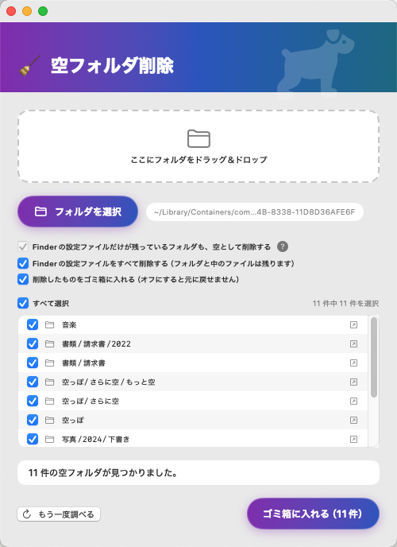

# 空フォルダ削除


散らかったフォルダの中から、**中身が空のフォルダをまとめて片付ける** macOS アプリです。
ターミナルは不要。フォルダをドラッグ＆ドロップするだけで使えます。

`.DS_Store` しか入っていないフォルダも「空」として扱えるので、Finder で見ると空なのに
削除できない、というフォルダもきれいになります。

<p align="center">
  
</p>

上の例では空のフォルダが11件見つかっています。実ファイルの入った「書類」フォルダ自体は
対象に含まれていません。消したくないものはチェックを外せます。

## 特長

- **深い階層も1回で**。削除してできた新しい空フォルダを自動で拾い直すので、
  何度もやり直す必要がありません
- **ゴミ箱に入れる**のが既定の動作。間違えても Finder の「戻す」で復元できます
- 入れ子の空フォルダはまとめて1項目としてゴミ箱に入るので、ゴミ箱が散らかりません
- **一覧で選んでから消せます**。行ごとのチェックボックスで対象を選び、
  右端のボタンでそのフォルダを Finder で開いて中身を確かめられます
- **途中で中止できます**。大きなフォルダでも、帯グラフと件数で進み具合が分かります
- シンボリックリンクは辿りません。選んだフォルダの外に出ることはありません
- **パッケージの中には入りません**。`.app`・写真ライブラリ・`.xcodeproj` などは、
  中に空のフォルダがあっても触りません
- **隠しフォルダの中には入りません**。`.git` などの内部構造を壊しません
- App Sandbox 対応。アクセスできるのは、あなたが選んだフォルダだけです
- **14言語に対応**しています（日本語・英語に加えて、インドネシア語・マレー語・韓国語・デンマーク語・タイ語・
  繁体字中国語・簡体字中国語・ドイツ語・スペイン語・フランス語・ベトナム語・ヒンディー語）。
  Mac の優先言語に合わせて切り替わり、名前も言語ごとに変わります（英語では `Empty Folder Sweeper`）

## インストール

[Releases](https://github.com/Ryuuji-sakura/EmptyFolderCleaner/releases) から `.dmg` を
ダウンロードして開き、`空フォルダ削除.app` を `Applications` フォルダにドラッグしてください。

**必要な環境**: macOS 14 (Sonoma) 以降

画面の言語は Mac の「優先する言語」に従います（日本語・英語と上の12言語）。どれも優先言語に無い場合は日本語で表示されます。

## 使い方

次のどれかでフォルダを渡すと、すぐにスキャンが始まります。

- ウィンドウにフォルダをドラッグ＆ドロップ
- **Dock アイコンにフォルダをドロップ**
- 「📁 フォルダを選択」ボタンから選ぶ

見つかった空フォルダが一覧で表示されます。既定では全部にチェックが入っているので、
**消したくないものはチェックを外して**から「ゴミ箱に入れる」を押してください。
確認ダイアログが出ます。

**行をダブルクリックすると、そのフォルダが Finder で開きます**（行の右端のボタンでも同じ）。
消す前に中身を確かめたいときに。

大きなフォルダを渡したときは「スキャン中... ○○項目」と進み具合が出ます。
時間がかかりすぎるときは「中止」を押してください。

すべてにチェックが入った状態で実行すると、削除してできた新しい空フォルダも続けて
片付けます。一部だけ選んだときは選んだものだけを消し、新しく空になったフォルダは
次の候補として一覧に出します。

### オプション

| 設定 | 既定 | 説明 |
| --- | --- | --- |
| Finderの設定ファイルだけが残っているフォルダも、空として削除する | ON | Finder が勝手に作る `.DS_Store` だけが残っているフォルダを、空として扱います |
| Finderの設定ファイルをすべて削除する | OFF | 中身のあるフォルダの中にある `.DS_Store` も消します。フォルダ自体と中のファイルはそのまま残りますが、そのフォルダの Finder 表示設定はリセットされます |
| 削除したものをゴミ箱に入れる | ON | オフにすると、ゴミ箱を経由せず完全に削除します（**元に戻せません**）。このときは確認ダイアログで Enter キーでは実行できないようにしてあります |

「Finderの設定ファイル」は `.DS_Store` のことです。アプリの中では、はじめて見る人にも
わかるようにこの呼び方をしています。

> **どれを `.DS_Store` とみなすか**
> 同期の衝突で `.DS_Store 12-34-56-789` のように名前が変わったものも対象にしますが、
> 名前だけでは判断しません。ファイルの中身が本当に Finder の作ったものかを確かめるので、
> 自分で `.DS_Store` から始まる名前を付けたファイルが消えることはありません。

> **`.DS_Store` を消すと何が起きる?**
> `.DS_Store` には、そのフォルダを Finder で開いたときの表示設定（ウィンドウの大きさ・位置、
> 表示形式、並び順、アイコンの位置）だけが入っています。フォルダ名やファイルの中身には
> 一切影響しません。次に Finder でそのフォルダを開くと自動的に作り直されます。

## 「空」の判定について

あるフォルダは、**そのフォルダ以下のどこにも実ファイルがない**ときに空とみなされます。
深い階層にファイルが1つでもあれば、その上のフォルダは削除されません。

なお、**あなたが選んだフォルダ自体は削除対象になりません**。消えるのはその中身だけです。

スキャンを途中で中止したときは、それまでに集めた候補をすべて捨てます。まだ見ていない
場所にファイルが残っているかもしれず、「空に見えただけ」のフォルダを消す候補に
するわけにはいかないからです。

## 開発

[XcodeGen](https://github.com/yonaskolb/XcodeGen) で `project.yml` から `.xcodeproj` を生成しています。

```sh
xcodegen generate
xcodebuild -project EmptyFolderCleaner.xcodeproj -scheme EmptyFolderCleaner \
  -configuration Release -derivedDataPath build build
```

テスト（ユニット51件 + UI 24件）:

```sh
xcodebuild -project EmptyFolderCleaner.xcodeproj -scheme EmptyFolderCleaner \
  -configuration Debug -derivedDataPath build test
```

スキャンと削除のロジックは `EmptyFolderCleaner/FolderSweeper.swift` にまとまっていて、
AppKit にも main actor にも依存していないため、実ファイルシステム上で直接テストできます。

`UITests/` は実際のアプリを起動して操作する E2E テストです。LaunchServices 経由で
フォルダを開くことで、サンドボックスの許可が付いた本番同様の状態を作っています。
画面の日本語を照合するので、優先言語が日本語の Mac で実行してください（それ以外の環境では
自動的に飛ばされます）。`EnglishScreenTests` だけは、英語で起動して画面に日本語が残って
いないことを確かめるテストで、環境の言語に関係なく動きます。設定は起動引数で固定し、
UI では切り替えないので、途中で失敗しても開発機のアプリの設定は書き換わりません。

### 文言（日本語・英語・12言語）

画面に出す文は `EmptyFolderCleaner/Localizable.xcstrings` に全言語を持ちます。キーは日本語の
原文そのものです（日本語を直したら、同じ原文のキーの全言語の訳も直す）。件数から組み立てる文は
`SweepMessages.swift` にまとめてあり、**英語の文面はユニットテストが言語を指定して検証**します。

```sh
./Scripts/check-localization.py
```

画面のリテラルとカタログの食い違い（訳の抜け・引数の不一致・`String` 経由で翻訳されなくなった
箇所）を調べます。訳の無い文言はエラーにならず日本語のまま表示されるので、ビルドでは
気づけません。`release.sh` と `appstore.sh` の途中で自動的に走ります。
全言語について、訳の抜け・複数形の区分（es・fr は one/many/other）・書式指定子・かなの混入・
Dock の名前（`*.lproj/InfoPlist.strings`）と画面の中の名前の一致も見ます。
`--self-test` を付けると、検査そのものが見逃したり誤検出したりしないかを確かめます。
翻訳しない `String`（表示用のデータなど）は、その行に `l10n-ignore` と理由を書くと除外できます。

リリース（Developer ID 署名・公証・staple・検証）:

```sh
./Scripts/release.sh
```

## ライセンス

MIT License — [LICENSE](LICENSE) を参照してください。

### 翻訳を足す・直すとき

用語と決まりは `Localization/用語集.md`（アプリ名の表・言語ごとの決まり）。画面の訳は
`Scripts/translation-handoff.py`、App Store の文面（名前・サブタイトル・宣伝文・キーワード・説明・最新情報）は
`Scripts/metadata-handoff.py` で、言語ごとの作業ファイル（`Localization/work/`、git 管理外）を介して
書き出し→訳す→検査→取り込みます。取り込み済みの App Store 文面は `Localization/metadata/<言語>.json`、
元の文面は `Localization/metadata-source.json`。

`UITests/AllLanguagesScreenTests.swift` は、12言語を1つずつ実際に起動して、画面（初期・スキャン結果・
吹き出し・確認ダイアログ・メニュー・使いかたの窓）に日本語が残っていないことを確かめ、スクリーンショットを
`~/Library/Containers/com.ryuujisakura.emptyfoldercleaner.uitests.xctrunner/Data/tmp/AllLanguagesShots/` に
保存します（1言語あたり約1分）。単体テストの `MultiLanguageTests` は、組み立てた文に日本語・書式の穴が無いこと、
件数が桁の切れ目で入っていること、ボタン名を引用する文がそのボタンの訳と同じ語であることを全言語で確かめます。
